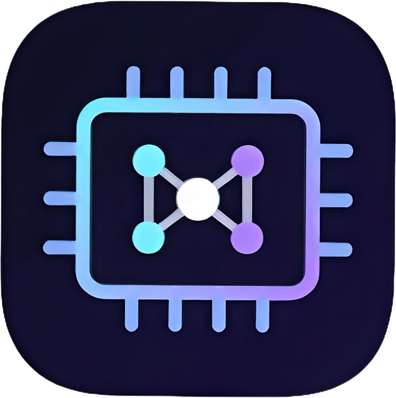

  

<h1 align="center">LSD Elite</h1>

  Private, on-device AI for Snapdragon phones and handhelds. 
  Chat and code with large language models that run <b>entirely on your device</b> — no account, no cloud.

  <b>Coming soon to Google Play</b>
  &nbsp;·&nbsp;
  <a href="PRIVACY.md">Privacy policy</a>

<!-- Add 2-4 screenshots here, e.g.:

 

-->

---

## What it is

LSD Elite runs open-weight language models locally on Qualcomm Snapdragon devices, using the GPU (Adreno)
and the NPU (Hexagon) instead of the CPU. Once a model is downloaded, everything works offline:
your conversations never leave the phone.

## Features

- **Chat and Code modes** — pick what you want when the app opens; each conversation keeps its own history.
- **Projects (folders)** — group conversations and give a folder instructions that apply to every chat inside it.
- **Model picker** — download several models, switch between them from the top of the chat.
- **"Think more" switch** for Qwen3 reasoning.
- **Live voice mode** — talk to the model using Android's on-device speech recognition and text-to-speech.
- **Background generation** — replies keep generating with the app closed; a notification takes you back to the chat.
- **Material You design** with dynamic colors and an optional pure-black AMOLED theme.
- **Multilingual UI** — English, Portuguese, German, Spanish, French, Hindi, Italian, Japanese, Russian and Chinese.

## Models

The Play Store edition only includes models whose licenses allow commercial redistribution:

| Model | License |
|---|---|
| Qwen3 8B | Apache-2.0 |
| Qwen3 4B | Apache-2.0 |
| Qwen 2.5 7B Instruct | Apache-2.0 |
| Qwen 2.5 Coder 7B | Apache-2.0 |

Models are downloaded on demand (roughly 2.5 GB for the 4B and 5 GB for the 8B), so make sure you have
free storage and a good connection for the first download. Full license texts and attributions are
available inside the app under **Settings → Licenses**.

## Requirements

- Android 12 or newer.
- A **Snapdragon** device. There is deliberately **no CPU fallback**: on other chips the app tells you
  local models are unavailable instead of running slowly.
- **12 GB of RAM or more** is recommended for the 8B models; 8 GB is enough for the 4B.
- Some Snapdragon handhelds ship firmware without the Hexagon DSP interface (for example, early builds
  of some devices). On those, the app shows a clear message instead of crashing; a firmware update may fix it.

## Privacy

No accounts, no analytics, no ads. Conversations are stored only on your device. The app connects to the
internet only to download model files. See the [privacy policy](PRIVACY.md).

## About this repository

This repository hosts the public description, screenshots and policies for LSD Elite.
**The source code is not published**, and the app is not open source. Copyright © 2026 DFDX047.
All rights reserved — see [LICENSE](LICENSE).

## Third-party software

LSD Elite is built with the [GenieX SDK](https://github.com/qualcomm/GenieX) (BSD-3-Clause, subject to
Qualcomm's Terms of Use), ggml/llama.cpp (MIT), AndroidX/Jetpack Compose, Kotlin, OkHttp and Coil (Apache-2.0),
and the Qwen models listed above. Attributions are available inside the app under **Settings → Licenses**.
Qwen is a trademark of its respective owner; LSD Elite is not affiliated with or endorsed by Alibaba Cloud or Qualcomm.

## Support

Found a bug or have a device that does not work? Open an [issue](../../issues) and include your device model
and Android version.
